# Arquitectura de Dash CV Master — Flujos de sesión, datos, estadísticas, uso, chat, reseñas, valoración y restablecimiento

> Documento de referencia del **dashboard web** (Vite + React + Firebase). Describe cómo viaja cada dato desde la app móvil (React Native) hasta una tarjeta o tabla del dashboard, qué lee y qué escribe cada pestaña, qué reglas de Firestore lo permiten y cómo se borra o se reinicia cada cosa. Está pensado como guía para no romper la relación entre **la app que escribe**, **Firestore que valida** y **el dashboard que lee y administra**.

> **Leyenda de esta versión:**
> - 🆕 = flujo o sección **nuevo** en esta versión.
> - 🔄 = flujo o sección **actualizado** en esta versión.
> - Lo que no tiene marca se mantiene igual.

> **Resumen de los cambios de esta versión:** 🆕 las métricas de **Uso** dejaron de calcularse con un documento por evento (`dashboard_interactions`) y pasaron a **contadores agregados en un solo documento**, `dashboard_config/uso_contadores`, que la app solo **suma** (una escritura en bloque con `increment`) y el dashboard escucha **en vivo** con un único `onSnapshot` sobre ese documento (se actualiza solo y solo mientras la pestaña Uso está abierta). 🆕 La pestaña **Perfiles** se eliminó (sus métricas pasaron a tarjetas dentro de Uso). 🔄 La pestaña **Uso** se rehízo por completo: tarjetas de uso, tarjetas de botones del modo edición y tablas de Tamaños, Ajustes e Idiomas. 🔄 La pestaña **Historial** (componente `Datos.jsx`, "Restablecer datos") ya no tiene la casilla Perfiles, y la casilla **Uso** borra el documento nuevo y además limpia las colecciones viejas `dashboard_interactions` y `dashboard_profiles`. Se **perdieron** dos métricas a propósito: "desplazamiento realizado" (solo queda el toque del botón Desplazar) y la tabla "Uso por plantilla". Ver flujos **9**, **10** y **18** y los puntos **22.1 a 22.12**.

---

## Índice de flujos

| # | Flujo | Pregunta que responde |
|---|---|---|
| 1 | Arquitectura general | ¿Cómo se conectan la app, Firestore y el dashboard? |
| 2 | Sesión y pestañas | ¿Quién puede entrar y cómo se elige la pestaña? |
| 3 | Conexión a Firebase y caché local | ¿Cómo se ahorran lecturas al recargar? |
| 4 | Mapa de Firestore | ¿Qué colecciones y documentos existen y quién escribe en cada uno? |
| 5 | Reglas de seguridad | ¿Qué puede hacer la app sin sesión y qué solo el dashboard? |
| 6 | Carga de eventos y estado de carga | ¿Cómo se traen los eventos y cuándo se avisa que están incompletos? |
| 7 | Tarjetas y tablas genéricas | ¿Cómo se dibuja cualquier tarjeta o tabla? |
| 8 | Estadísticas de plantillas | ¿Cómo se pasa de eventos de descarga a filas por plantilla, familia y colección? |
| 9 | 🆕 Uso (contadores en vivo) | ¿Cómo se muestra el uso de la app y se mantiene al día? |
| 10 | 🆕 De la app al documento de uso | ¿Cómo llegan los contadores a `uso_contadores`? |
| 11 | Onboarding | ¿Qué eligieron los usuarios al activar la experiencia mejorada? |
| 12 | Reseñas | ¿Cómo llega una reseña de la app al dashboard y cómo se vincula a un chat? |
| 13 | Valoración (me gusta / no me gusta) | ¿Cómo se votan y se cuentan los diseños? |
| 14 | Reinicio de me gusta / no me gusta | ¿Cómo se vuelve a preguntar "¿Te gustó el diseño?"? |
| 15 | Chat de ayuda | ¿Cómo hablan la app y el soporte, y cómo se sabe quién está conectado? |
| 16 | Gestionar historial del chat | ¿Cómo se borran mensajes viejos y se permite reseñar de nuevo? |
| 17 | Reiniciar onboarding | ¿Cómo se limpian las estadísticas de onboarding? |
| 18 | 🔄 Restablecer datos (pestaña Historial) | ¿Cómo se pone todo en cero de forma segura? |
| 19 | Distribución y versiones | ¿Cómo sabe la app cómo compartirse y qué versiones hay? |
| 20 | Estilos y responsive | ¿Cómo se adapta el dashboard a celular y tablet? |
| 21 | Costos y cuota de Firestore | ¿Cuánto cuesta cada pestaña y cómo se controla? |
| 22 | Puntos de atención | Riesgos y detalles a verificar |
| 23 | Checklists | ¿Cómo se agrega una métrica, una pestaña, una columna o una colección? |
| 24 | Archivos no revisados | ¿Qué partes de este documento no se verificaron contra el código? |

---

## 1. Arquitectura general

Este flujo responde a: **¿cómo se conectan la app, Firestore y el dashboard?**

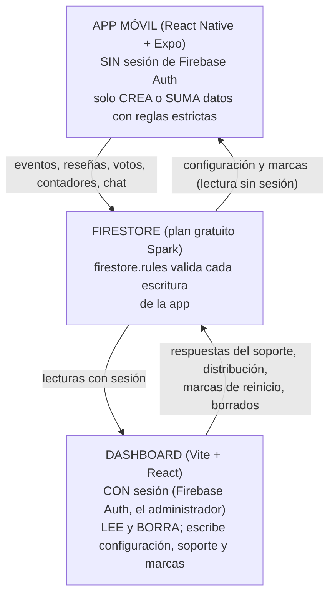

Reglas de fondo:

- **La app no tiene sesión.** Todo lo que escribe lo hace sin `request.auth`, así que las reglas son la única defensa y solo pueden **limitar** la forma de lo que se escribe, no impedir que alguien suba datos falsos (punto 22.3).
- **El dashboard sí tiene sesión.** Con sesión puede leer todo, borrar todo y escribir los documentos de configuración y las respuestas del soporte.
- **Dos maneras de guardar métricas** conviven en el proyecto:
  1. **Un documento por evento** (descargas de plantillas, onboarding, reseñas, votos). Cada pestaña descarga los eventos y los agrupa en memoria.
  2. **Contadores agregados en un documento** (`diseno_contadores` y, 🆕, `uso_contadores`). La app solo suma; el dashboard lo lee (🆕 en Uso, escuchando ese único documento). Es el patrón preferido porque gasta muy pocas lecturas y escrituras (flujo 21).
- Si la app no puede escribir (sin red o sin cuota), **sigue funcionando normal**: nunca depende de que Firebase responda.

### 1.1 Estructura de carpetas (según los archivos revisados)

```
src/
├── App.jsx                     sesión + pestañas
├── firebase.js                 app, db (caché persistente), auth, analytics
├── config.js                   nombres de colecciones, documentos, tipos de evento y límites
├── catalogo.js                 catálogo de plantillas, familias, etapas, extras, profesiones (no revisado)
├── datos.js                    eventos de plantillas → filas por plantilla / familia / colección
├── datosApp.js                 🔄 onboarding y uso (contadores)
├── columnas.js                 🔄 definición de columnas de todas las tablas
├── estilos.css                 diseño y responsive
├── components/                 Resumen, TablaDatos, EstadoCarga, MenuPropiedades, Login,
│                               ModalHistorial, ModalReinicioDisenos, ModalReinicioOnboarding
├── hooks/                      useColeccion, useColumnas, useChats, 🆕 useUsoContadores
├── secciones/                  Estadisticas, 🔄 Uso, Onboarding, Resenas, Chat, Versiones,
│                               Distribucion, Valoracion, 🔄 Datos (= pestaña Historial)
└── servicios/                  historial.js, onboarding.js, disenos.js, 🆕 uso.js
```

> **Nombres que confunden.** La pestaña se llama **Historial** pero su componente es `secciones/Datos.jsx` ("Restablecer datos"). El `ModalHistorial.jsx` es **otra cosa**: es el modal "Gestionar historial" del **chat** (flujo 16), y se abre desde la pestaña Chat.

---

## 2. Sesión y pestañas

Este flujo responde a: **¿quién puede entrar y cómo se elige la pestaña?**

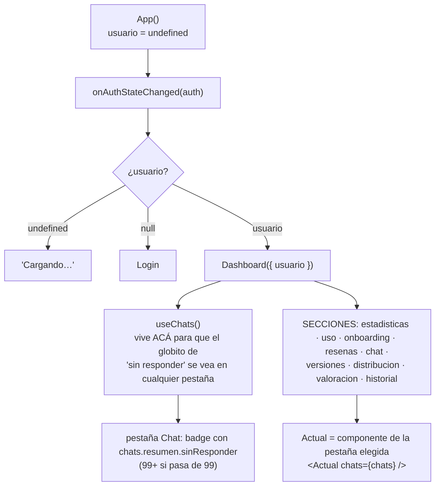

Reglas:

- **Solo se monta una pestaña a la vez.** Al cambiar de pestaña, la anterior se **desmonta** y pierde su estado local. Los datos en vivo (🆕 el uso) se vuelven a suscribir al volver a la pestaña y se desuscriben al salir (flujo 9).
- Todas las pestañas reciben la prop `chats`, aunque solo Chat la usa.
- La pestaña inicial es `estadisticas`. "Historial" va **siempre al final**.
- Cerrar sesión llama `signOut(auth)`; `onAuthStateChanged` devuelve `null` y se vuelve al Login.
- 🔄 Ya **no existe** la pestaña Perfiles (se borró de `SECCIONES` y se eliminó `secciones/Perfiles.jsx`).

---

## 3. Conexión a Firebase y caché local

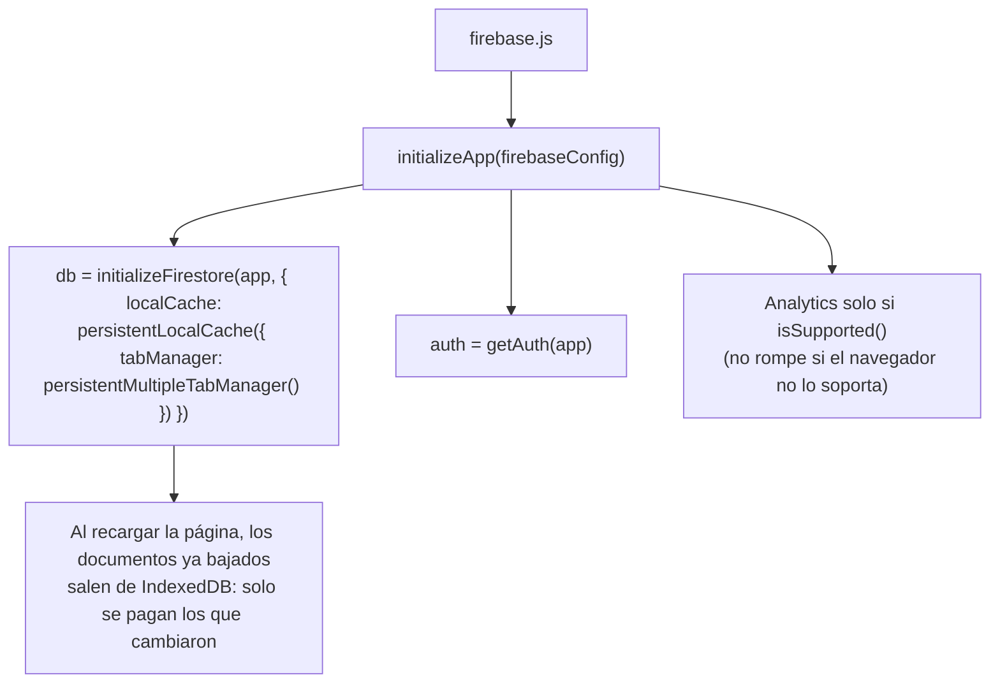

Reglas:

- La **caché persistente** funciona con varias pestañas del navegador abiertas (`persistentMultipleTabManager`). El ahorro vale mientras el cierre dure menos de unos 30 minutos.
- `getDoc` con red disponible consulta al servidor; **sin red** devuelve lo que haya en caché (puede ser un dato viejo, punto 22.5).
- Los valores de `firebaseConfig` (incluida la `apiKey`) son públicos por diseño en una app web: la protección real son las **reglas de Firestore** y la sesión.
- Todos los archivos importan `db` y `auth` de `src/firebase.js`. Nunca se inicializa Firebase dos veces.

---

## 4. Mapa de Firestore

Este flujo responde a: **¿qué colecciones y documentos existen y quién escribe en cada uno?**

Los nombres salen de `COLECCIONES` y de las constantes `DOC_*` en `config.js`.

| Ruta | Constante | Qué guarda | Escribe | Lee | Estado |
|---|---|---|---|---|---|
| `dashboard_events` | `PLANTILLAS` | PDF generados (`plantilla_descargada`) y diseños agregados desde la biblioteca (`plantilla_biblioteca`) | App | Dashboard | Vigente |
| `dashboard_onboarding` | `ONBOARDING` | `onboarding_completado` y `onboarding_admin_uso` (más `editado` y `desactivado`, que la app ya no envía) | App | Dashboard | Vigente |
| `dashboard_reviews` | `RESENAS` | Reseñas de la app (nombre, estrellas, texto, idioma, `chatId`) | App (crea y edita) | Dashboard | Vigente |
| `dashboard_design_feedback` | `DISENOS` | Un voto por usuario y diseño (id `userId_nombre`) | App | Dashboard (solo borra) | Vigente |
| `dashboard_config/diseno_contadores` | `DOC_CONTADORES_DISENOS` | `{ likes: {...}, dislikes: {...} }` | App (suma 1) y dashboard | Dashboard | Vigente |
| `dashboard_config/diseno_resets` | `DOC_REINICIO_DISENOS` | Marcas `{ resetTodoEn, resets: { "CV-06": ms } }` | Dashboard | **App (sin sesión)** | Vigente |
| 🆕 `dashboard_config/uso_contadores` | `DOC_USO_CONTADORES` | Contadores de uso (5 grupos, flujo 9) | App (solo suma) y dashboard | Dashboard | **Nuevo** |
| `dashboard_config/distribucion` | — | Cómo se comparte la app (APK o Play, URLs, mensajes) | Dashboard | **App (sin sesión)** | Vigente |
| `chats/{userId}` | `CHATS` | Ficha del usuario del chat (presencia, último mensaje) | App y dashboard (campos distintos) | App (la suya) y dashboard | Vigente |
| `chats/{userId}/messages/{id}` | — | Mensajes de usuario y soporte | App (usuario) y dashboard (soporte) | Ambos | Vigente |
| `chats/{userId}/limites/{dia}` | — | Contador de mensajes del día | App | Dashboard | Vigente |
| `dashboard_profiles` | `PERFILES` | Eventos viejos de perfiles | App (APK viejas) | Nadie | **Deprecada** |
| `dashboard_interactions` | `USO` | Eventos viejos de uso | App (APK viejas) | Nadie | **Deprecada** |

Notas:

- Las dos colecciones **deprecadas** ya no se leen. Se conservan en `config.js` y en las reglas solo para que las APK ya instaladas no reciban errores, y para poder **limpiarlas** desde Historial > Uso (flujo 18).
- Los documentos de `dashboard_config` son **documentos únicos**: se leen con `getDoc` por id, nunca se listan.

---

## 5. Reglas de seguridad (`firestore.rules`)

Este flujo responde a: **¿qué puede hacer la app sin sesión y qué solo el dashboard?**

> El archivo advierte en su cabecera que **no hay que reemplazar** el `firestore.rules` publicado si tiene otras colecciones: hay que copiar las funciones y los bloques `match` dentro del archivo actual, y después **publicar** las reglas en Firebase.

### 5.1 Funciones de validación

| Función | Valida |
|---|---|
| `eventoValido(tipos)` | Forma `{ tipo, nombre, plataforma, createdAt, plantillaId?, extra? }`; `tipo` dentro de la lista; `nombre` ≤ 120; `createdAt == request.time` |
| `resenaValida()` | Reseña nueva: `tipo == 'resena_enviada'`, nombre 1–40, estrellas entero 1–5, texto ≤ 300, `idioma?` ≤ 5, `chatId?` ≤ 60 |
| `resenaEditadaValida()` | Reseña editada: mismas formas, pero `createdAt` y `chatId` **no pueden cambiar**; permite `editadaEn == request.time` |
| `disenoFeedbackValido(id)` | Voto `diseno_like` o `diseno_dislike`; `userId` 10–60; el **id del documento debe ser `userId + '_' + nombre`** (un voto por usuario y diseño) |
| `mapaUno(m)` | Mapa con exactamente un diseño y valor 1 (primer voto) |
| `cambioUnDiseno(nuevo, viejo)` | El mapa cambió en **una sola** clave |
| 🆕 `usoEstructuraOk()` | Primer nivel `hasOnly(['uso','editor','tamanos','ajustes','idiomas'])`, cada grupo es `map` y con **exactamente** las claves del modelo |
| 🆕 `usoCrearDelta(g,k)` / `usoActualizarDelta(g,k)` | Valor entero; en create entre 0 y 1000; en update, **nuevo − existente** entre 0 y 1000 |
| 🆕 `usoCrearOk()` / `usoActualizarOk()` | Una llamada explícita por clave (las reglas no tienen bucles) |

### 5.2 Quién puede qué

| Bloque | App (sin sesión) | Dashboard (con sesión) |
|---|---|---|
| `dashboard_events` | `create` si `eventoValido(['plantilla_descargada','plantilla_biblioteca'])` | `read`, `delete` |
| `dashboard_onboarding` | `create` con 4 tipos válidos | `read`, `delete` |
| `dashboard_profiles` / `dashboard_interactions` (deprecados) | `create` de los tipos viejos | `read`, `delete` |
| `dashboard_reviews` | `create` (`resenaValida`) y `update` (`resenaEditadaValida`) | `read`, `delete` |
| `dashboard_design_feedback` | `create` (`disenoFeedbackValido(id)`); `update` prohibido | `read`, `delete` |
| `diseno_resets` | `get` libre | `create`/`update` (claves `resetTodoEn`, `resets`, `actualizadoEn`), `delete` |
| `diseno_contadores` | `create` con un solo voto; `update` cambiando un solo diseño de un solo mapa | todo |
| 🆕 `uso_contadores` | `create` (`usoCrearOk`) y `update` (`usoActualizarOk`); **nunca `delete`** | todo (`get`, `create`, `update`, `delete`) |
| `distribucion` | `get` libre | `create`, `update`, `delete` |
| `chats/{userId}` | `get` libre; `create` (campos de la app); `update` sin tocar campos del soporte | `list`, todo |
| `chats/.../messages` | `read` libre; `create` del usuario (≤ 500 caracteres, ≤ 10 por día) | `create`/`update`/`delete` de mensajes de soporte (≤ 2000) |
| `chats/.../limites` | `create` (count = 1), `update` (count + 1, máximo 10) | `read`, `delete` |

Reglas de fondo:

- **El borrado siempre es del dashboard** (`delete: if request.auth != null`). La app nunca borra nada.
- 🆕 En `uso_contadores` el delta máximo es **1000 por clave y por escritura**: acota el daño de un envío falso, pero no lo impide (punto 22.3).
- **Hay que publicar las reglas** cada vez que cambian. Un `permission-denied` al borrar o leer casi siempre es "reglas sin publicar" o "sin sesión" (los mensajes de error del dashboard lo indican).

---

## 6. Carga de eventos y estado de carga

Este flujo responde a: **¿cómo se traen los eventos y cuándo se avisa que están incompletos?**

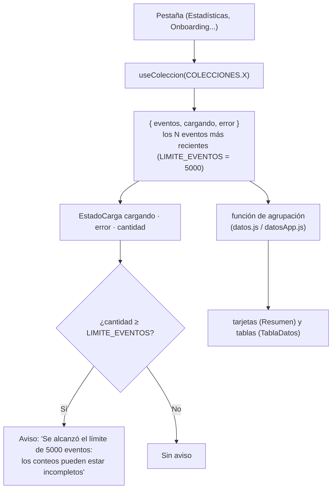

Reglas:

- **Todo se calcula sobre los 5000 eventos más recientes.** Si hay más, los contadores pueden **bajar** en vez de crecer (los eventos más viejos quedan afuera). `EstadoCarga` avisa cuando se llega al tope.
- `EstadoCarga` recibe `{ cargando, error, cantidad }`. Si la pestaña no usa eventos (🆕 Uso), se le pasa `cantidad={0}` para que nunca muestre el aviso del límite.
- 🔄 **Uso ya no usa `useColeccion`**: lee un documento, no una colección (flujo 9).
- Límites relacionados en `config.js`: `LIMITE_RESENAS = 500`, `LIMITE_CHATS = 500`, `LIMITE_MENSAJES_CHAT = 300`. `LIMITE_DISENOS` ya no se usa (Valoración lee contadores).
- La implementación interna de `useColeccion` no se revisó para este documento (flujo 24).

---

## 7. Tarjetas y tablas genéricas

Este flujo responde a: **¿cómo se dibuja cualquier tarjeta o tabla?**

### 7.1 Tarjetas: `Resumen`

`Resumen({ tarjetas })` recibe `[{ label, valor }]` y dibuja una grilla de `.card`. La **`key` de cada tarjeta es el `label`**, así que los labels de un mismo `Resumen` deben ser **únicos**.

### 7.2 Tablas: `TablaDatos`

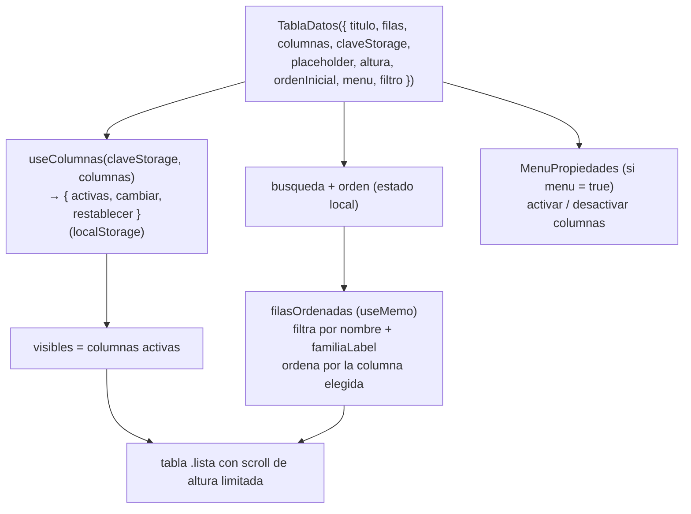

Reglas de `TablaDatos`:

- **Contrato de columna:** `{ key, label, align, inicial, valor(fila), render?(fila) }`. `valor` se usa para **ordenar** (y para mostrar si no hay `render`); `render` solo cambia el texto de la celda. `inicial` dice si la columna está visible por defecto.
- **Clave de fila:** `f.clave ?? f.nombre`. Si dos filas repiten `nombre` y no traen `clave`, React advierte claves duplicadas.
- **Filtro de texto:** busca en `` `${f.nombre} ${f.familiaLabel ?? ""}` ``.
- **Orden:** al hacer clic en un encabezado alterna ▲/▼. Las columnas `nombre` y `familia` empiezan ascendentes; el resto, descendentes. Textos con `localeCompare(..., { numeric: true })`; números por resta; empates por `nombre`.
- **La columna de orden puede estar oculta.** `orden.key` se busca en **todas** las columnas (no solo las visibles), así que una columna con `inicial: false` y sin menú sirve para fijar un orden (🆕 Tamaños, Ajustes e Idiomas, flujo 9).
- **`menu={false}`** oculta el menú de propiedades; **`filtro={false}`** oculta la caja de búsqueda. Las tablas chicas (Uso) usan ambos en `false`.
- **`altura`** es un `max-height` (por ejemplo `"30vh"`): la tabla scrollea por dentro en lugar de alargar la página.
- **`claveStorage`** guarda en `localStorage` qué columnas están activas. Cada tabla necesita **su propia clave** (prefijo `dash-cv-master:cols-...`). `useColumnas` mezcla lo guardado con los valores iniciales, así que una columna **nueva** aparece con su valor `inicial` sin romper lo guardado.

### 7.3 Columnas (`columnas.js`)

| Exportación | Tabla |
|---|---|
| `COLUMNAS_PLANTILLAS` | Plantillas de familia (nombre, familia, descargas y propiedades opcionales: última descarga, Android, iOS, perfil de prueba, tiempos, con/sin experiencia mejorada) |
| `COLUMNAS_FAMILIAS` | Familias profesionales (PDF familia, PDF ATS, total, última) |
| `COLUMNAS_COLECCION` | Diseños de la colección (nuevos diseños, PDF) |
| `COLUMNAS_AREAS`, `COLUMNAS_ETAPAS`, `COLUMNAS_EXTRAS` | Onboarding (nombre, cantidad, %) vía `columnasConteo` |
| 🆕 `COLUMNAS_TAMANOS`, `COLUMNAS_AJUSTES`, `COLUMNAS_IDIOMAS` | Uso (nombre, veces, %, y la columna oculta `orden`) vía `columnasUso` |

> Se eliminaron `COLUMNAS_PROFESIONES`, `COLUMNAS_USO_PLANTILLA` y `COLUMNAS_ACCIONES` junto con la pestaña Perfiles y las tablas viejas de Uso.

---

## 8. Estadísticas de plantillas

Este flujo responde a: **¿cómo se pasa de eventos de descarga a filas por plantilla, familia y colección?**

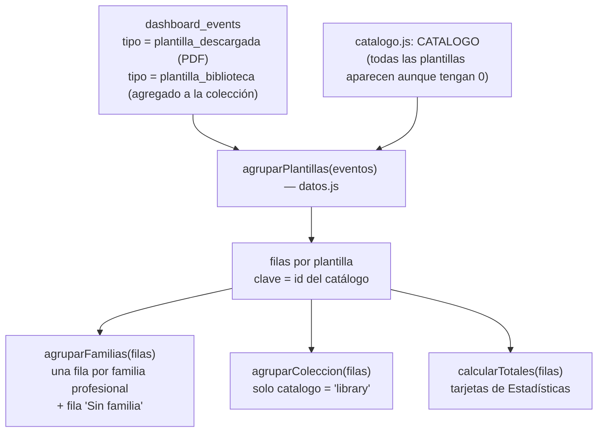

### 8.1 Cómo se asigna un evento a una plantilla (`buscarEnCatalogo`)

1. Por **`plantillaId`** (único), verificando que el nombre coincida con el del catálogo.
2. Si es una **ATS** (`nombre === "ATS"`), por familia: `extra.familiaPlantilla` o `extra.familia`. Las ATS se llaman igual en todas las familias, así que **el nombre no alcanza**.
3. Para los demás, por **nombre** (único fuera de las ATS).
4. Si no está en el catálogo del dashboard, se crea una fila propia con clave `ev|nombre|plantillaId`.

### 8.2 Qué cuenta cada columna

- **Agregado desde la biblioteca** (`plantilla_biblioteca`): suma en `coleccion`. **No es un PDF.**
- **PDF generado** (`plantilla_descargada`): suma en `pdfFamilia` o `pdfColeccion` según `modoDe(e)`.
- `modoDe(e)` devuelve `"coleccion"` si `extra.modo === "coleccion"`, o `extra.catalogo === "library"`, o `extra.familia === "new_design"`; si no, `"familia"`. Los eventos viejos se reconocen por catálogo y familia.
- `pdfFamiliaSinFam`: PDF de familia que llegaron con familia `sin_familia`. En `agruparFamilias` van a la fila "Sin familia" y **no** se cuentan además en la familia real, para que todo sume igual.
- Con/sin experiencia mejorada: `extra.experienciaMejorada` `true` / `false` / ausente (`sinDato`, eventos viejos).
- Promedios: `duracionPdfMs` (tiempo de PDF) y `segDesdeSeleccion` (segundos hasta descargar). Solo se promedian valores numéricos válidos (`>= 0`).
- `ultima`: el `createdAt` más reciente del PDF.

### 8.3 Tarjetas de totales (`calcularTotales`)

| Tarjeta | Cálculo |
|---|---|
| `pdfFamilia` | PDF de diseños de familia, **sin** ATS y **sin** colección |
| `pdfAts` | PDF de plantillas ATS, de cualquier origen |
| `pdfColeccion` | PDF de diseños de la colección, sin ATS |
| `nuevosDisenos` | Suma de `coleccion` (agregados desde la biblioteca) |
| `coleccion` | `TOTAL_COLECCION` (del catálogo, no de eventos) |

> `claveDe(nombre, familia)` sigue exportada desde `datos.js`. Antes la usaba `agruparUso` (ya eliminada): su comentario quedó desactualizado (punto 22.7).

---

## 9. 🆕 Uso (contadores en vivo)

Este flujo responde a: **¿cómo se muestra el uso de la app y se mantiene al día?**

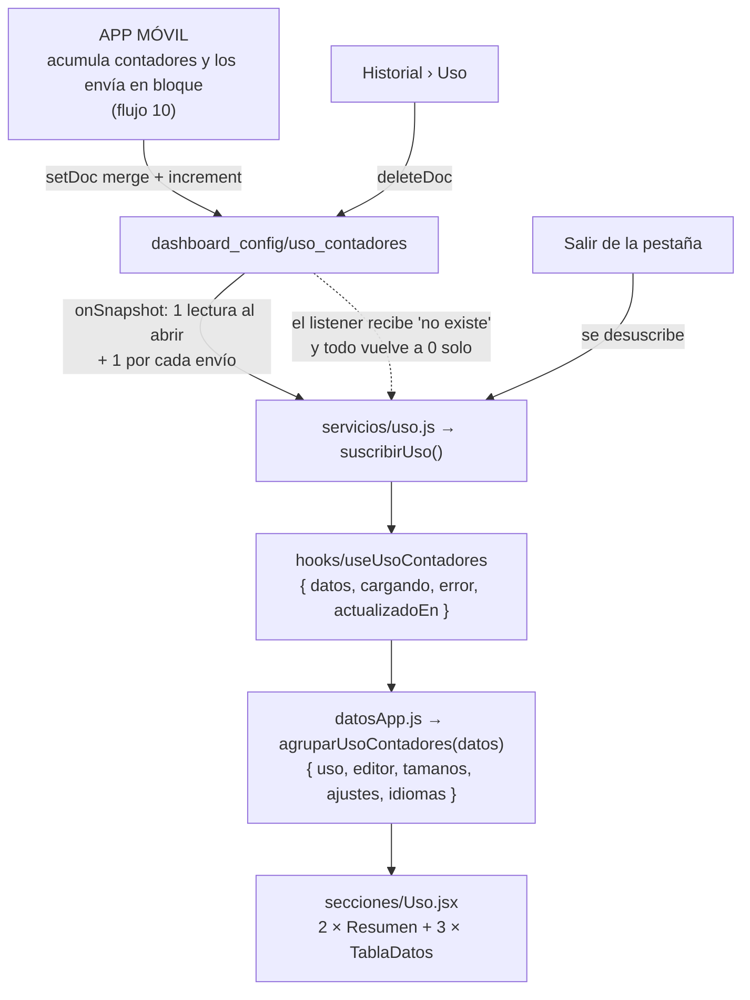

### 9.1 Estructura del documento

```
{
  uso:     { paginacion_cambiada, editor_abierto, wizard_usado,
             perfil_nuevo_inicio, perfil_nuevo_mis_perfiles,
             perfil_activado_prueba, perfil_activado_real },
  editor:  { imagen, experiencia, datos, tamano, desplazar, vista },
  tamanos: { x0_9, x1_0, x1_1, x1_2, x1_3 },
  ajustes: { abierto, idioma_cambiado, modo_oscuro_on, modo_oscuro_off,
             compartir, acerca_de, terminos },
  idiomas: { es, en, pt }
}
```

Las claves **no tienen puntos** (`x1_0`, no `1.0x`): con rutas con punto Firestore las interpretaría como separador de campos.

### 9.2 Qué muestra la pestaña (en este orden)

| Sección | Componente | Contenido |
|---|---|---|
| Línea superior | texto | "Se actualiza solo · último cambio a las HH:MM:SS" |
| Uso | `Resumen` (7 tarjetas) | Cambios de paginación · Modo edición abierto · Wizard usado · Perfil nuevo desde Inicio · Perfil nuevo desde Mis perfiles · Perfil activado (prueba) · Perfil activado (real) |
| Modo edición — botones | `Resumen` (6 tarjetas) | Imagen · Experiencia · Datos · Tamaño · Desplazar · Vista |
| Tamaños | `TablaDatos` | 0.9x, 1.0x, 1.1x, 1.2x, 1.3x **siempre visibles** (aunque sean 0): Tamaño · Veces · % |
| Idiomas | `TablaDatos` | Español · Inglés · Portugués: Idioma · Veces · % |
| Ajustes | `TablaDatos` | Ajustes abiertos · Cambios de idioma · Modo oscuro activado · Modo oscuro desactivado · Compartir aplicación · Acerca de · Términos y condiciones |

Tamaños e Idiomas van lado a lado en una `.rejilla` (se apilan en pantallas angostas). Todas las tablas usan `menu={false}` y `filtro={false}`. **No hay botón Actualizar**: la pestaña se actualiza sola.

### 9.3 Cómo se calculan los porcentajes (`agruparUsoContadores`)

- **Tamaños e Idiomas:** `% = veces / suma del grupo`. Si la suma es 0, el % es 0.
- **Ajustes:** `% = veces / ajustes.abierto` (respecto de las **veces que se abrió Ajustes**). La fila "Ajustes abiertos" no lleva % (se muestra "—").
- Cada valor se normaliza: si no es un número finito mayor que 0, vale 0.
- Las filas llevan un campo `orden` (posición en la lista) y la columna oculta `orden` hace que se vean siempre en el mismo orden.

### 9.4 Suscripción (`servicios/uso.js` + `hooks/useUsoContadores.js`)

| Pieza | Qué hace |
|---|---|
| `suscribirUso(alCambiar, alFallar)` | `onSnapshot` del documento. Entrega los datos, o `null` si el documento no existe. Devuelve la función para dejar de escuchar |
| `useUsoContadores()` | Se suscribe al montar la pestaña y se desuscribe al desmontarla. Guarda `datos`, `cargando`, `error` y `actualizadoEn` |
| `borrarContadoresUso()` | Lee el documento y, si existe, lo borra. Devuelve 1 o 0 |

Reglas:

- **Es un solo documento**, así que el listener cuesta 1 lectura al abrir y 1 por cada envío de la app mientras la pestaña está abierta. Con la pestaña cerrada no cuesta nada.
- Si el documento **no existe**, todo se muestra en 0 y aparece un aviso que lo dice explícitamente: la app todavía no envió nada **o** Firestore rechazó el envío (por ejemplo, reglas sin publicar). Es la primera pista para diagnosticar "no se ven valores".
- Errores: `permission-denied` → "Sin permiso para leer. Publicá las reglas e iniciá sesión."; cualquier otro → "No se pudo leer el uso.".
- La consola del navegador muestra `[uso] uso_contadores: existe / todavía no existe` en cada actualización.
- La caché persistente de Firestore (flujo 3) hace que, al reabrir, los datos ya conocidos se muestren al instante y solo se paguen los cambios.

---

## 10. 🆕 De la app al documento de uso

Este flujo responde a: **¿cómo llegan los contadores a `uso_contadores`?** (lado de la app, resumido para entender qué esperar en el dashboard)

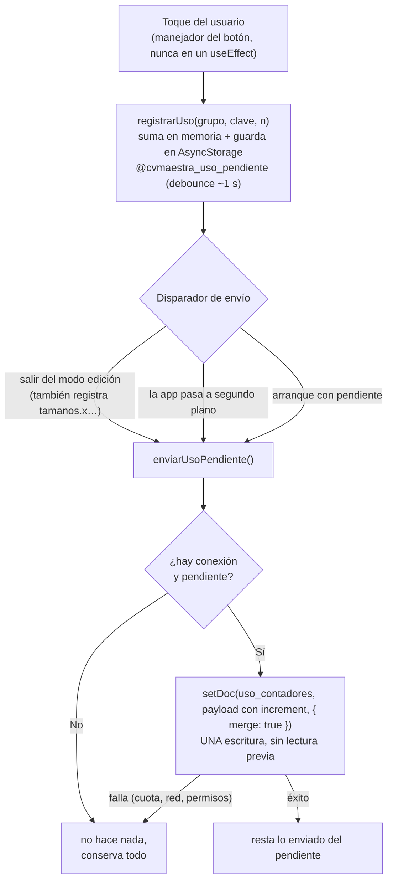

Reglas del lado de la app (las que explican lo que se ve en el dashboard):

- **Cero escrituras por evento.** Todo se acumula y se envía en bloque.
- **Wizard:** `wizard_usado` suma **1 por flujo de creación** desde "Crear nuevo CV" (no por toque). Tocar el wizard editando un perfil existente suma 0.
- **Perfiles:** `perfil_activado_prueba` y `perfil_activado_real` cuentan solo el toque de "Activar", **no** las activaciones automáticas (perfil de prueba por defecto, activación al crear un perfil). `perfil_nuevo_inicio` y `perfil_nuevo_mis_perfiles` no cuentan la creación automática de "Perfil 1".
- **Tamaño de letra:** `tamanos.x…` guarda el tamaño que **quedó seleccionado al salir del modo edición**. `editor.tamano` cuenta cuántas veces se abrió el panel. `x1_0` incluye a quienes nunca tocaron Tamaño (es el valor por defecto).
- **Ajustes:** `idioma_cambiado` e `idiomas.<codigo>` se cuentan solo cuando el idioma **realmente cambia**; `compartir` solo con internet.
- **Tope por clave** de 1000 en el pendiente, para no superar el límite de las reglas.
- Cada envío falso o con claves desconocidas lo **rechazan** las reglas (flujo 5).
- La app no tiene textos nuevos para esto: no hay UI de uso en la app.

---

## 11. Onboarding

Este flujo responde a: **¿qué eligieron los usuarios al activar la experiencia mejorada?**

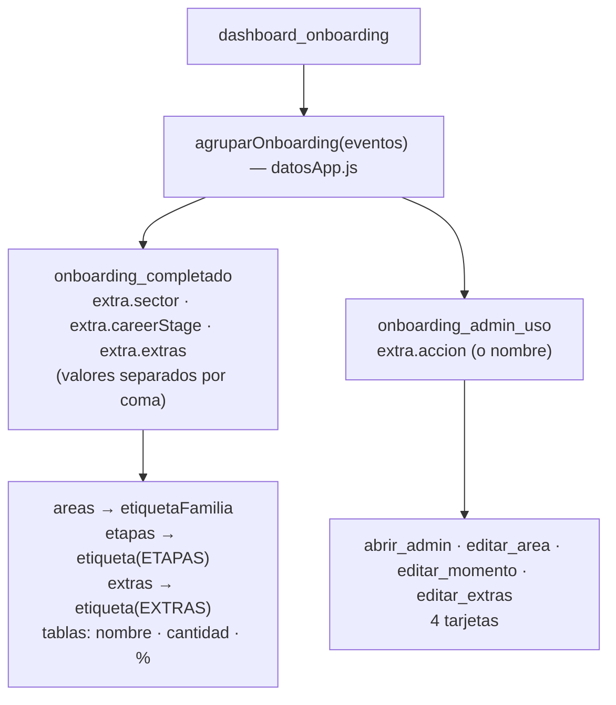

Reglas:

- `partir("a,b,c")` convierte el texto en lista sin vacíos; sin dato devuelve `[]`.
- **Un evento aporta varias filas** (un usuario con tres extras suma 1 en cada uno), así que el % de una tabla es **respecto de las selecciones**, no de los usuarios.
- `filasConteo` calcula `pct = cantidad / total`.
- Las etiquetas se resuelven con `catalogo.js` (`etiquetaFamilia`, `etiqueta`).
- `onboarding_editado` y `onboarding_desactivado` ya no se muestran (la app tampoco los envía), pero las reglas los siguen aceptando por compatibilidad.
- Se reinicia desde Historial (flujos 17 y 18).

---

## 12. Reseñas

Este flujo responde a: **¿cómo llega una reseña de la app al dashboard y cómo se vincula a un chat?**

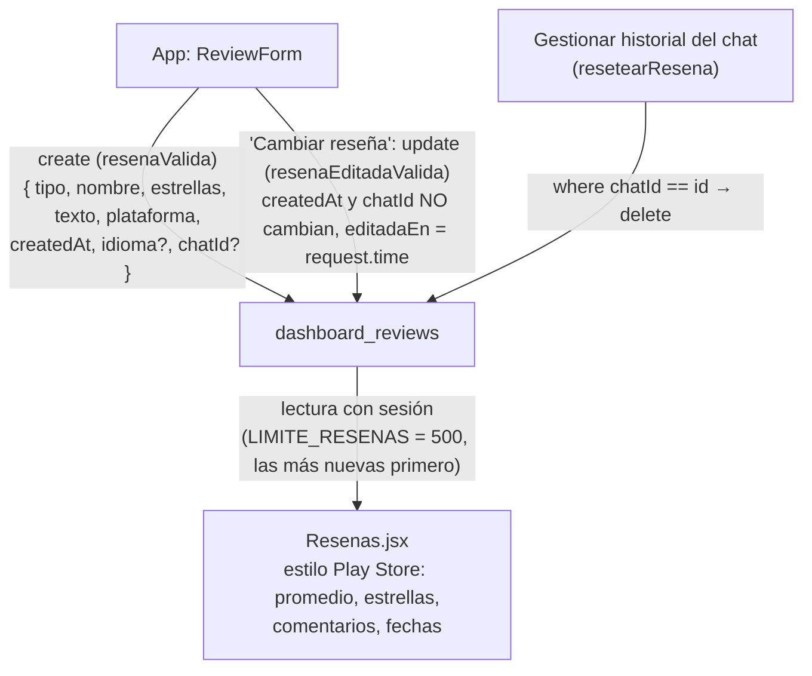

Reglas:

- `chatId` es el **id anónimo del usuario** de la app: permite borrar su reseña al limpiar su historial (flujo 16). Las reseñas **viejas** (antes de existir `chatId`) no se pueden vincular a un usuario y solo se borran desde Historial > Reseñas (flujo 18).
- La reseña se puede **editar desde la app** (reglas: `update`), pero **borrar solo desde el dashboard**.
- Los textos de las reseñas son contenido escrito por usuarios: se muestran como texto, nunca como instrucciones. El CSS usa `overflow-wrap: anywhere` en `.resena p`.

---

## 13. Valoración (me gusta / no me gusta)

Este flujo responde a: **¿cómo se votan y se cuentan los diseños?**

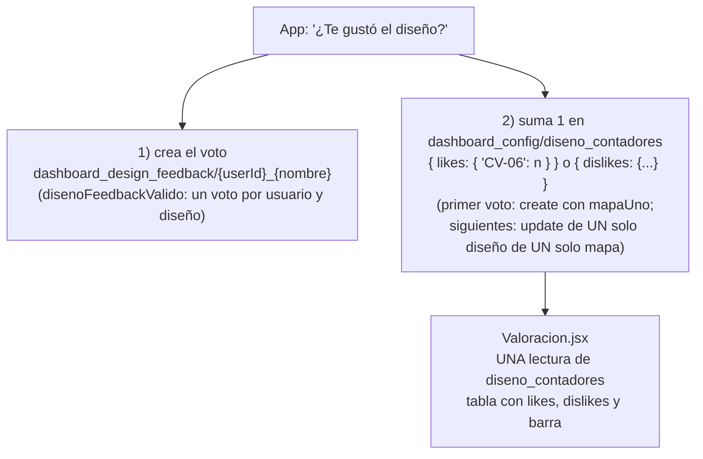

Reglas:

- `nombre` es el **nombre del diseño del catálogo** (ejemplo `CV-06`), no su id. La app lo limpia igual que el dashboard (`limpiarNombreDiseno`: recorta, reemplaza `/` por `-` y corta a 100 caracteres).
- El **id del voto** hace que no se pueda votar dos veces el mismo diseño, ni editar el voto.
- El dashboard **no cuenta votos uno por uno**: lee el documento de contadores. Si alguna vez los números no coinciden con los votos reales, `recalcularContadores()` los recuenta y los reescribe (flujo 14).
- Tipos: `TIPO_DISENO_LIKE = "diseno_like"`, `TIPO_DISENO_DISLIKE = "diseno_dislike"`.

---

## 14. Reinicio de me gusta / no me gusta

Este flujo responde a: **¿cómo se vuelve a preguntar "¿Te gustó el diseño?"?**

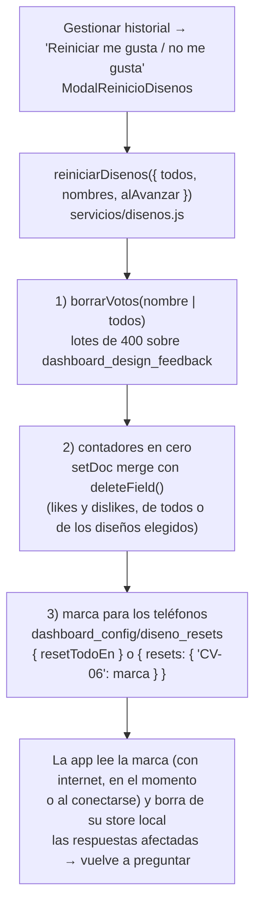

Reglas:

- **El orden importa.** Hay que borrar los votos **primero**: las reglas no dejan crear dos veces el mismo voto (id `userId_nombre`), así que si el voto viejo siguiera ahí, el usuario no podría volver a votar.
- La **marca** es un número que **solo crece**: `max(Date.now(), mayor marca anterior + 1)`, para que sea mayor a cualquiera previa aunque el reloj de la PC esté atrasado. Cada teléfono recuerda la última que aplicó.
- Se escribe con `merge: true` para conservar las marcas de los demás diseños.
- Si algo falla a mitad de camino, **se corta y se puede reintentar**: todos los pasos se pueden repetir.
- `recalcularContadores()` recorre `dashboard_design_feedback` ordenado por id en páginas de 500 y reescribe `{ likes, dislikes }` completo.

---

## 15. Chat de ayuda

Este flujo responde a: **¿cómo hablan la app y el soporte, y cómo se sabe quién está conectado?**

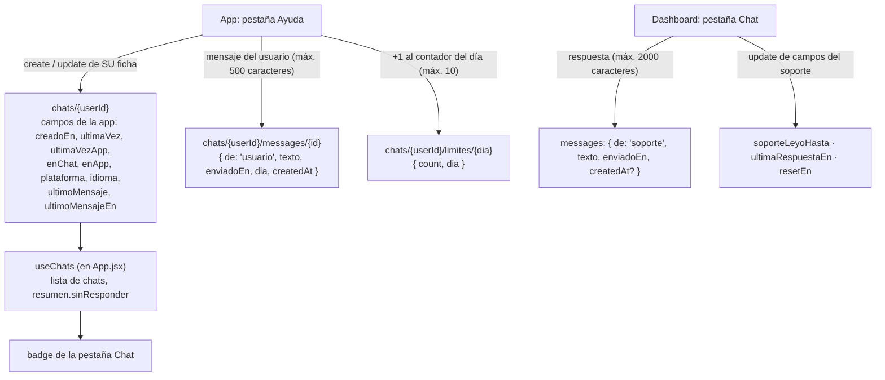

Reglas:

- **Dos dueños de campos.** La app escribe `camposApp()`; el dashboard escribe `camposSoporte()` (`soporteLeyoHasta`, `ultimaRespuestaEn`, `resetEn`). La regla `soporteIntacto()` impide que la app los cambie.
- **Límite diario:** un mensaje del usuario solo se crea si el contador del día (`getAfter(... limites/{dia})`) quedó en **10 o menos**, por eso la app debe escribir el mensaje y el contador **juntos** (en la misma operación atómica).
- **Presencia:** la app avisa que está en el chat o dentro de la app cada ~60 segundos. El dashboard considera "en línea" a quien avisó hace menos de `ACTIVO_MS` (2 minutos). Sin WebSocket, es una aproximación.
- **Listado:** `LIMITE_CHATS = 500` (los de actividad más reciente), `LIMITE_MENSAJES_CHAT = 300` al abrir un chat.
- **Editar mensajes propios:** el soporte puede editar solo sus mensajes (`de == 'soporte'`), cambiando el texto y marcándolos con `editadoEn`; el autor y las fechas originales no se tocan.
- **"Sin responder":** la ficha guarda `ultimoMensajeEn` (último del usuario) y `ultimaRespuestaEn` (último del soporte); `useChats` los compara. Al responder, el soporte actualiza esos campos.
- La pestaña Chat tiene un cuarto botón **Gestionar historial** (flujo 16). En celular, la lista y la conversación se alternan (flujo 20).
- `Chat.jsx` y `useChats.js` no se revisaron en detalle (flujo 24).

---

## 16. Gestionar historial del chat

Este flujo responde a: **¿cómo se borran mensajes viejos y se permite reseñar de nuevo?** (`ModalHistorial.jsx` + `servicios/historial.js`)

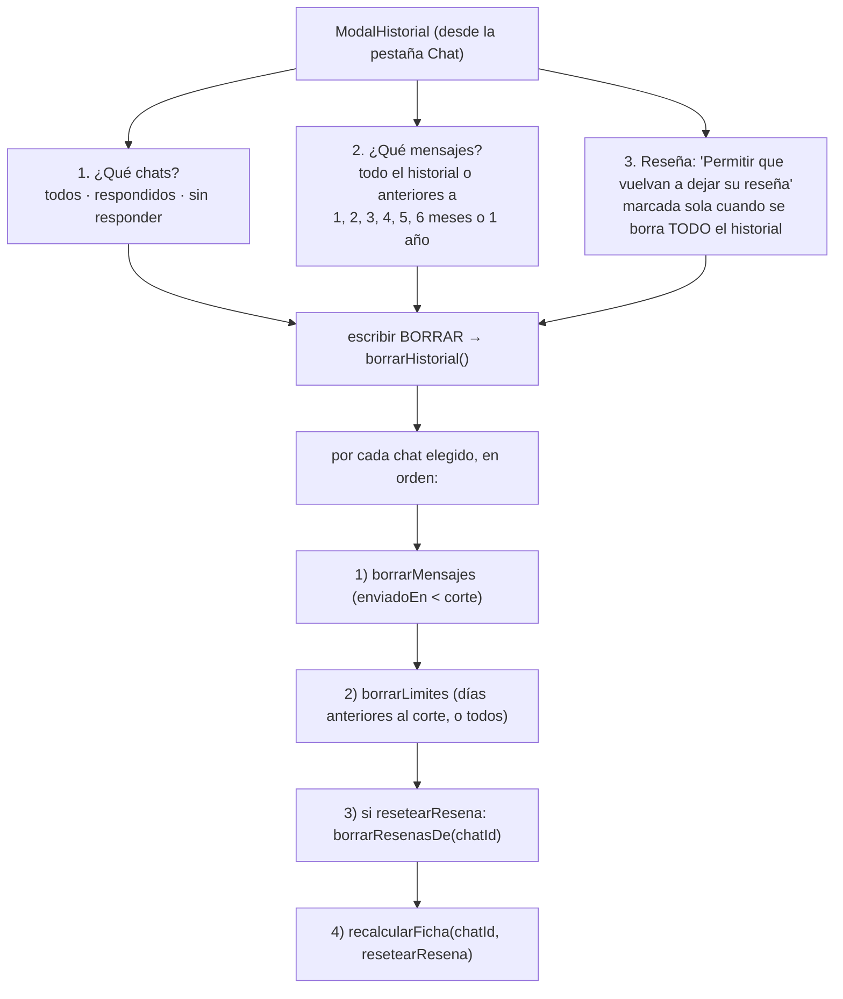

Reglas:

- **La ficha del chat no se borra** (así el chat conserva su número). `recalcularFicha` la deja coherente con lo que quedó: último mensaje, `ultimoMensajeEn`, `ultimaRespuestaEn`; si no quedaron mensajes, `soporteLeyoHasta = 0`.
- **Resetear la reseña** borra las reseñas con ese `chatId` y escribe `resetEn = Date.now()` en la ficha. La app, al verlo, olvida la reseña y vuelve a mostrar "Deja tu reseña".
- **`corteDe(meses)`:** resta meses a la fecha de hoy (`null` = borrar todo). Los contadores diarios se llaman como el día (`"2026-10-22"`), y se borran los **anteriores al día del corte** comparando textos.
- **Borrado en tandas** de 400 (`TANDA`), con avance. Cada documento borrado cuenta para la cuota de borrados del día.
- `recalcularFicha` mira solo los **últimos 50 mensajes** que quedaron (punto 22.15).
- Desde este mismo modal se abren otros dos modales de reinicio: **me gusta / no me gusta** (flujo 14) y **onboarding** (flujo 17). Los estados del modal principal se conservan al volver.

---

## 17. Reiniciar onboarding

Este flujo responde a: **¿cómo se limpian las estadísticas de onboarding?** (`ModalReinicioOnboarding.jsx` + `servicios/onboarding.js`)

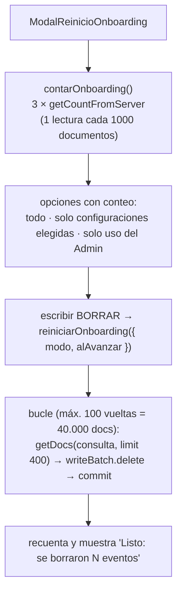

| Modo | Borra | Alimenta |
|---|---|---|
| `todo` | Toda la colección (incluye `editado` y `desactivado` viejos) | — |
| `completados` | Solo `onboarding_completado` | Tablas: Áreas, Extras, Momento laboral |
| `admin` | Solo `onboarding_admin_uso` | Las 4 tarjetas de arriba |

Reglas:

- **No afecta a quienes ya activaron la experiencia mejorada en la app:** solo limpia las **estadísticas** del dashboard.
- Contar casi no gasta lecturas (agregación). Borrar necesita **leer cada documento** (1 lectura por documento) para conocer su id.
- El botón se deshabilita si no hay nada que borrar (`afectados === 0`) o mientras borra.

---

## 18. 🔄 Restablecer datos (pestaña Historial)

Este flujo responde a: **¿cómo se pone todo en cero de forma segura?** (`secciones/Datos.jsx`)

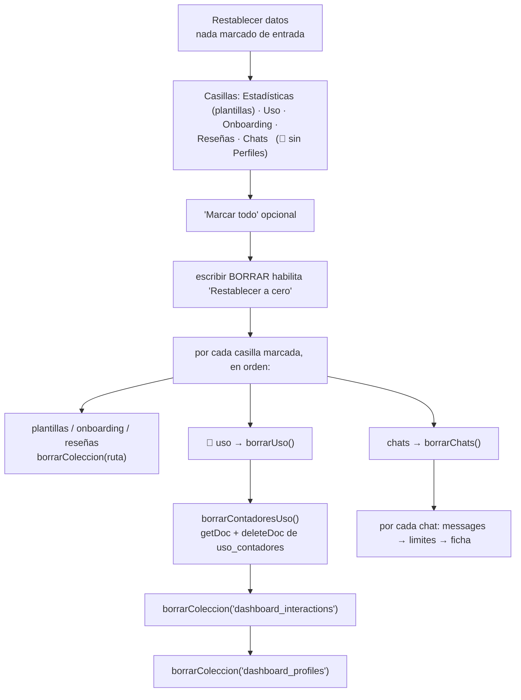

Reglas:

- **Seguridad:** nada marcado de entrada, hay que escribir `BORRAR`, se borra en tandas de 400 y se muestra el avance. Es **irreversible**.
- 🔄 **Uso** significa ahora tres cosas: el documento `dashboard_config/uso_contadores` **más** las colecciones viejas `dashboard_interactions` y `dashboard_profiles` (que pueden seguir recibiendo eventos de APK antiguas). La casilla **Perfiles** se eliminó porque su dato vive ahora en Uso.
- **`borrarContadoresUso`** hace `getDoc` antes de borrar (1 lectura) para devolver 1 solo si el documento existía, así el total "documentos borrados" es real.
- **Chats:** Firestore no borra subcolecciones desde el cliente, por eso se recorren los chats uno por uno (mensajes, contadores, y recién después la ficha).
- **Error parcial:** si falla a mitad de camino el mensaje indica cuántos documentos se borraron antes de fallar, y se puede **volver a intentar** sin problema. `permission-denied` se explica como "publicá las reglas e iniciá sesión".
- Los borrados **cuentan para la cuota diaria** de borrados de Firestore (20.000, verificar el valor vigente en la documentación oficial).
- Esta pestaña **no** borra: los votos de diseños ni sus contadores (eso es el flujo 14), ni el documento de distribución, ni nada de `diseno_resets`.

---

## 19. Distribución y versiones

Este flujo responde a: **¿cómo sabe la app cómo compartirse y qué versiones hay?**

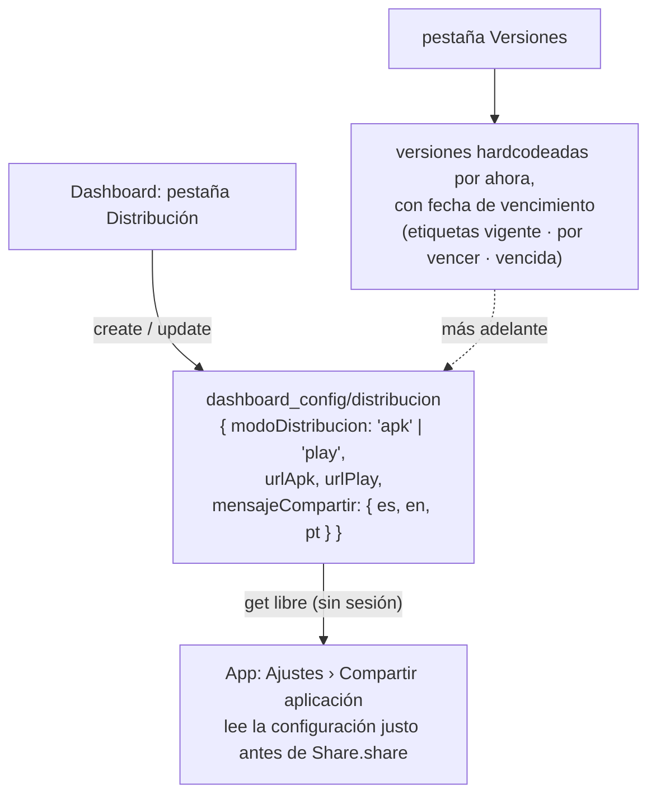

Reglas:

- La app **solo lee** la distribución; el dashboard **solo escribe**.
- Más adelante, `distribucion` compartirá documento con el control de versiones (`versionCodeActual`, etc.), según el comentario de las reglas.
- Las etiquetas de estado de versión usan `.etiqueta.vigente`, `.por-vencer` y `.vencida`.
- `Distribucion.jsx` y `Versiones.jsx` no se revisaron (flujo 24): este flujo describe el documento y las reglas.

---

## 20. Estilos y responsive

Este flujo responde a: **¿cómo se adapta el dashboard a celular y tablet?** (`estilos.css`)

### 20.1 Tokens y tema

- Variables en `:root`: `--acento` (`#4560db`, el azul de la app: si no coincide **exacto**, cambiar solo este valor), `--acento-suave`, `--fondo`, `--superficie`, `--superficie-alt`, `--borde`, `--texto`, `--gris`, `--error`, `--estrella`, `--verde`, `--sombra`.
- **Modo oscuro automático** con `@media (prefers-color-scheme: dark)`: redefine todas las variables y cambia el encabezado a superficie con borde.
- Tipografía base 14 px; `-webkit-text-size-adjust` fijo.

### 20.2 Piezas y clases principales

| Clase | Uso |
|---|---|
| `.encabezado` / `.encabezado-in` | Banda azul con título y usuario |
| `.contenedor` / `.contenido` | Ancho máximo 1200 px |
| `.menu` / `.tab` / `.tab.activa` / `.tab-badge` | Pestañas |
| `.resumen` / `.card` | Tarjetas (`auto-fit`, mínimo 170 px) |
| `.panel` / `.panel-head` / `.panel-acciones` | Paneles con título y acciones |
| `.scroll` / `.lista` / `.left` `.right` `.center` | Tablas con scroll interno |
| `.rejilla` | Dos tablas lado a lado (mínimo 380 px; se apilan solas) |
| `.etiqueta`, `.estrellas`, `.resena`, `.promedio` | Versiones y reseñas |
| `.chat-*`, `.burbuja*` | Chat (lista + conversación) |
| `.valoracion-filtros`, `.chip-filtro`, `.barra-valoracion*` | Valoración |
| `.peligro*`, `.datos-lista`, `.datos-item`, `.btn-peligro` | Restablecer datos y modales de reinicio |
| `.aviso`, `.error`, `.estado-carga`, `.vacio` | Estados |

### 20.3 Puntos de corte

| Ancho | Cambios |
|---|---|
| ≤ 1100 px | Las pestañas pasan a una **grilla** que se acomoda sola (se ven todas, nunca se cortan); la activa se marca con fondo, sin rayita |
| ≤ 800 px | Encabezado en columna; tarjetas en **2 por fila**; `.rejilla` en 1 columna; tablas compactas con **scroll horizontal y primera columna fija** (`position: sticky`); **Chat: se ve la lista O la conversación** (`.con-seleccion`, botón volver) |
| ≤ 480 px | Pestañas más chicas; **campos a 16 px** (evita el zoom automático de iOS) |
| Pantallas táctiles (`pointer: coarse`) | Botones y pestañas más altos (40 y 46 px) |

Reglas:

- Alturas con `dvh` (con respaldo `vh`) para que no se corten con la barra del navegador del celular.
- Un componente nuevo con tabla debe vivir dentro de `.scroll` para heredar el scroll horizontal y la primera columna fija.
- Los títulos de sección de la pestaña 🆕 Uso (`Uso`, `Modo edición — botones`) usan estilo en línea: no hay clase propia en el CSS.

---

## 21. Costos y cuota de Firestore

Este flujo responde a: **¿cuánto cuesta cada pestaña y cómo se controla?**

Cuota gratuita (Spark), a verificar siempre en la documentación oficial: **20.000 escrituras, 50.000 lecturas y 20.000 borrados por día**; se reinicia a medianoche (hora del Pacífico).

| Pestaña / acción | Lecturas | Escrituras / borrados | Nota |
|---|---|---|---|
| 🆕 Uso (abierta) | **1** al abrir + 1 por cada envío de la app mientras la pestaña esté abierta | 0 | `onSnapshot` de un solo documento; se desuscribe al salir de la pestaña |
| Valoración | 1 (`diseno_contadores`) | 0 | Contadores en un documento |
| Estadísticas, Onboarding | hasta 5000 (los eventos más recientes) | 0 | Con caché persistente, al recargar solo se pagan los cambios |
| Reseñas | hasta 500 | 0 | |
| Chat | hasta 500 chats + hasta 300 mensajes por chat abierto | respuestas del soporte | |
| Reiniciar onboarding | 1 por documento a borrar (+ conteos) | 1 por documento | |
| 🔄 Restablecer datos | 1 por documento a borrar (+ 1 por `uso_contadores`) | 1 por documento | Cuenta para la cuota de borrados |
| Reiniciar diseños | 1 por voto a borrar + 1 de la marca | votos + contadores + marca | |
| 🆕 App → uso | 0 | **1 por envío** (no por evento) | `setDoc` merge + `increment`, sin lectura previa |

Reglas:

- **Cuota consumida:** el SDK cliente **no expone** cuántas lecturas o escrituras se usaron hoy. El dato exacto está en la **consola de Firebase** (Firestore › Uso) y en Cloud Monitoring. Por decisión, el dashboard **no** muestra tarjetas de cuota y no inventa números. Una estimación automática exacta requeriría una Cloud Function con plan **Blaze** (en Blaze pasar la cuota **se factura**, no se corta).
- Si se agota la cuota del día, la app **sigue funcionando**: los contadores quedan guardados en el dispositivo y se reenvían en el próximo disparador.

---

## 22. Puntos de atención

Detalles a verificar al tocar este código.

### 22.1 a 22.12 — Uso y métricas (🆕 / 🔄)

1. **Perfiles.jsx debe borrarse a mano.** Si queda en `src/secciones/`, no rompe nada pero es código muerto, y todavía importa cosas que ya no existen.
2. **Constantes eliminadas de `config.js`:** `PERFIL_SELECCIONADO`, `PERFIL_ACTIVADO`, `PERFIL_REAL`, `USO_PAGINACION`, `USO_EDITOR`, `USO_DESPLAZAR`. Si algún archivo no revisado las importaba, Vite marcará error de import: hay que buscarlas y quitarlas.
3. **Las reglas no impiden números falsos.** Sin autenticación, cualquiera con la configuración pública puede sumar hasta 1000 por clave y por escritura. Endurecimiento futuro: **Firebase App Check**.
4. **Las colecciones deprecadas siguen vivas** mientras haya APK viejas que envíen esos eventos. Los bloques `dashboard_profiles` y `dashboard_interactions` de las reglas se borran cuando ya no queden versiones viejas; la casilla Uso de Historial las limpia mientras tanto.
5. **Sin red, el listener entrega la caché local**, que puede ser un dato viejo; se corrige solo al volver la conexión.
6. **Cada envío de la app cuesta 1 lectura mientras la pestaña Uso está abierta** (con la pestaña cerrada no cuesta nada). Con muchos usuarios y el dashboard abierto todo el día, conviene vigilar el consumo (flujo 21).
7. **`claveDe` de `datos.js`:** su comentario dice que la usa `agruparUso`, que ya no existe. Sigue exportada por si otro archivo la usa; si nadie la importa, se puede borrar.
8. **Métricas que se perdieron a propósito:** "desplazamiento realizado" (solo queda el toque del botón Desplazar, `editor.desplazar`) y la tabla "Uso por plantilla".
9. **`x1_0` no significa "eligieron 1.0x":** incluye a quienes nunca tocaron Tamaño. El contexto lo da `editor.tamano`.
10. **El % de Ajustes puede pasar de 100%** (por ejemplo, modo oscuro activado varias veces en una sola apertura). Es respecto de las aperturas, no de usuarios.
11. **Las métricas son de eventos, no de personas.** Nada de `uso_contadores` identifica usuarios.
12. **Un contador que baja** indica que alguien reinició el documento (Historial › Uso) y la app volvió a sumar desde cero.

### 22.13 a 22.24 — Datos, reglas y borrado

13. **Truncado a 5000 eventos** (flujo 6): los conteos de eventos pueden estar incompletos, y pueden **bajar**.
14. **Reseñas sin `chatId`** (anteriores a esa versión) no se borran con "permitir reseñar de nuevo": solo desde Historial › Reseñas.
15. **`recalcularFicha`** mira solo los últimos 50 mensajes que quedaron: si hay más y la ficha queda inconsistente, hay que abrir el chat y responder.
16. **Un borrado puede quedar a medias** si falla la red. Es seguro reintentar (se vuelve a leer lo que queda).
17. **`update` de reseñas** (`allow update: if resenaEditadaValida()`) **no exige sesión ni comprueba que quien edita sea el autor**: solo impide cambiar `createdAt` y `chatId`. Alguien que conozca el id de una reseña podría editarla. Es un riesgo conocido de las reglas sin autenticación.
18. **Lecturas libres del chat:** `chats/{userId}` permite `get` y `messages` permite `read` a cualquiera que conozca el `userId` (la app lo necesita porque no tiene sesión). El `userId` es un id largo y anónimo, pero conviene **no mostrarlo ni compartirlo**.
19. **El archivo `firestore.rules` entregado puede no ser el publicado.** Hay que copiar los bloques nuevos dentro del archivo real (no reemplazarlo) y **publicar**.
20. **Marcas de reinicio de diseños:** solo crecen. No hay forma de "deshacer" un reinicio; las respuestas borradas de los teléfonos se vuelven a pedir.
21. **Orden de borrado de chats:** subcolecciones primero, ficha al final. Si se corta antes, queda una ficha sin mensajes (inofensivo, y reintentar la completa).
22. **`claveStorage` repetida** entre dos tablas haría que compartan las columnas activas. Cada tabla necesita la suya.
23. **Columna `orden` oculta:** si algún día se agrega un menú de propiedades a Tamaños, Ajustes o Idiomas, la columna aparecería en la lista: habría que excluirla.
24. **`localStorage`:** las columnas activas se guardan por navegador; otro navegador o un perfil nuevo arranca con los valores iniciales.

---

## 23. Checklists

### 23.1 Agregar una métrica nueva de uso (un contador)

1. **App:** agregar la clave al tipo del grupo en `uso_service.ts`, y llamar `registrarUso(grupo, clave)` en el manejador del toque.
2. **Reglas:** agregar la clave en `usoEstructuraOk` (en el `hasOnly` del grupo), en `usoCrearOk` y en `usoActualizarOk` (una llamada `usoCrearDelta` y una `usoActualizarDelta`). **Publicar.**
3. **Dashboard:** agregar `[clave, "Etiqueta"]` a la lista del grupo en `datosApp.js` (`TARJETAS_USO`, `TARJETAS_EDITOR`, `TAMANOS`, `AJUSTES` o `IDIOMAS`). No hace falta tocar `Uso.jsx`.
4. Una clave nueva que no esté en las reglas **hace fallar todo el envío** (las reglas son estrictas): probar siempre contra Firestore real.

### 23.2 Agregar un grupo nuevo al documento de uso

Además de lo anterior: agregarlo a `usoEstructuraOk` (primer nivel y `hasOnly`), crear su lista en `datosApp.js`, devolverlo desde `agruparUsoContadores`, y mostrarlo en `Uso.jsx` con `Resumen` o `TablaDatos` (con sus columnas en `columnas.js`).

### 23.3 Agregar una pestaña

1. Crear `secciones/Nueva.jsx` (recibe la prop `chats`, aunque no la use).
2. Importarla en `App.jsx` y agregar `{ id, label, componente }` a `SECCIONES` (Historial siempre al final).
3. Si lee datos, definir su colección en `COLECCIONES` y usar `useColeccion` o un servicio con `getDoc`.
4. Si debe conservar datos al cambiar de pestaña, guardarlos **fuera** del componente (como `servicios/uso.js`).
5. Si hay datos que borrar, agregarla a `OPCIONES` de `Datos.jsx`.

### 23.4 Agregar una tabla o columna

1. Definir las columnas en `columnas.js` (`key`, `label`, `align`, `inicial`, `valor`, `render?`).
2. Usar `TablaDatos` con una `claveStorage` **nueva**.
3. Para un orden fijo, usar una columna oculta (`inicial: false`) y `ordenInicial` apuntando a ella (con `menu={false}`).

### 23.5 Agregar una colección a "Restablecer datos"

1. Agregarla a `COLECCIONES` en `config.js`.
2. Agregar una entrada a `OPCIONES` de `Datos.jsx` (`id`, `label`, `detalle`, `coleccion`).
3. Si guarda subcolecciones o documentos especiales, escribir una función de borrado propia (como `borrarChats` o `borrarUso`) y marcar la opción con una bandera (`esChat`, `esUso`).
4. Confirmar que las reglas permiten `delete` con sesión.

### 23.6 Agregar un evento nuevo de la app

1. Agregar el tipo a `eventoValido([...])` del bloque correspondiente (o crear la colección con su bloque `match`).
2. Definir su constante en `config.js` y agruparlo en `datos.js` / `datosApp.js`.
3. **Publicar las reglas.**
4. Pensar si en vez de un evento conviene un **contador agregado** (flujos 9 y 10): casi siempre es más barato.

---

## 24. Archivos no revisados

Este documento se armó leyendo estos archivos: `firestore.rules`, `estilos.css`, `config.js`, `firebase.js`, `App.jsx`, `datos.js`, `datosApp.js`, `columnas.js`, `Resumen.jsx`, `TablaDatos.jsx`, `EstadoCarga.jsx`, `useColumnas.js`, `Uso.jsx`, `Datos.jsx`, `ModalHistorial.jsx`, `ModalReinicioOnboarding.jsx`, `servicios/historial.js`, `servicios/onboarding.js`, `servicios/disenos.js`, 🆕 `servicios/uso.js` y 🆕 `hooks/useUsoContadores.js`, además del prompt de métricas de uso.

**No se revisaron** (lo que este documento dice de ellos sale de cómo los usan otros archivos, de las reglas o de los comentarios): `main.jsx`, `catalogo.js`, `Login.jsx`, `MenuPropiedades.jsx`, `ModalReinicioDisenos.jsx`, `hooks/useColeccion.js`, `hooks/useChats.js`, `secciones/Estadisticas.jsx`, `Onboarding.jsx`, `Resenas.jsx`, `Chat.jsx`, `Versiones.jsx`, `Distribucion.jsx` y `Valoracion.jsx`. Si alguno de estos cambia lo descrito (por ejemplo si `useColeccion` usa `onSnapshot` o `getDocs`), **hay que corregir el flujo correspondiente** (6, 8, 11, 12, 13, 15 y 19).